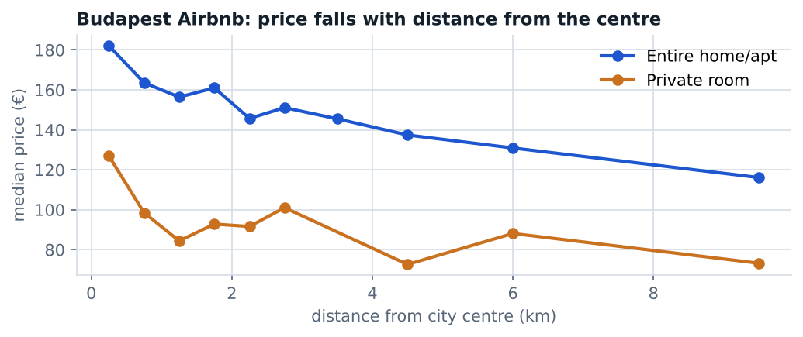

# Predicting Airbnb prices in Budapest

STAT 301 Statistical Modelling, UBC · November 2025 · course project, team of four

LASSO regression for the log price of Budapest Airbnb listings (weekday and weekend), with the penalty chosen by 10-fold cross-validation and performance measured on a held-out test set.

**Result.** The model kept nine predictors, led by room type, guest capacity, bedrooms, weekend status and location indices; test R² was 0.35 on the log scale, with a mean absolute error of about €45.

**My role:** I built the modeling pipeline and wrote the report.

**Run it.** `airbnb_budapest_lasso.ipynb` (R kernel; tidyverse, glmnet). Data: Gyódi & Nawaro (2021), [Determinants of Airbnb prices in European cities: A spatial econometrics approach](https://www.sciencedirect.com/science/article/pii/S0261517721000388), supplementary data; place `budapest_weekdays.csv` and `budapest_weekends.csv` in `airbnb-prices/`.
