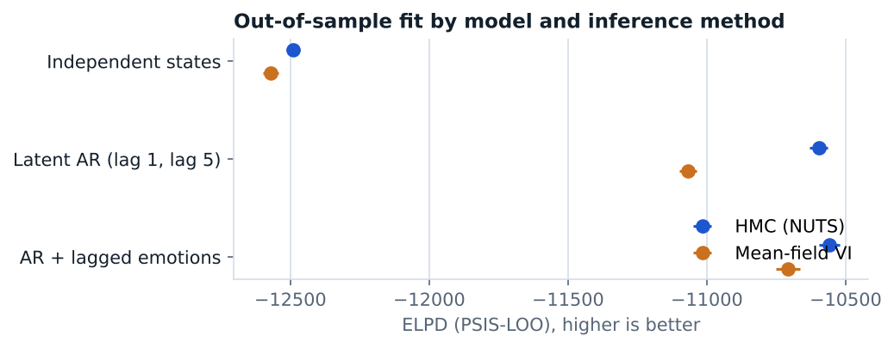

# Bayesian models for day-to-day emotion dynamics

STAT 405 Bayesian Statistics, UBC · April 2026 · two-person project

**Report:** [report.pdf](report.pdf) · original course repository: [STAT405-Project-](https://github.com/Marclianjie/STAT405-Project-)

Self-reported emotions are coarse, noisy snapshots of an underlying state. Using experience-sampling data (Kullar et al., 2024; 105 participants, nine emotions on a 1–7 scale, five prompts a day), I compared three Bayesian latent-state models for momentary happiness:

1. **Independent states** with an ordered-logistic measurement model.
2. **Latent autoregression** on the previous prompt and on the same prompt the day before (lag 5).
3. **Autoregression plus lagged emotions** (*enthusiastic*, *pleased*, *relaxed*), chosen by leave-one-subject-out one-step-ahead screening.

Each model was fit in Stan with NUTS and with mean-field variational inference, compared with PSIS-LOO, and checked with R̂, bulk and tail ESS, rank plots and exact invariance tests.

**Results.** Adding latent time structure raised ELPD by about 1,893 under HMC; lagged emotions added about 38 more. HMC outperformed mean-field VI for every model, with the largest gap (≈ 471) once temporal dependence entered, consistent with VI missing posterior correlation.

**My role:** I developed the models, implemented them in Stan, ran the diagnostics and the model comparison, and compiled the results.

## Files

| File | Contents |
|---|---|
| `naive_model.stan` | Independent latent states with an ordered-logistic likelihood |
| `intermediate_model.stan` | Latent autoregression on lag 1 and lag 5 |
| `advanced_model.stan` | Autoregression plus lagged *enthusiastic*, *pleased* and *relaxed* |
| `model_fitting.qmd` | Fitting with CmdStanR (NUTS and mean-field VI), diagnostics, PSIS-LOO comparison |
| `eda.rmd` | Exploratory analysis and leave-one-subject-out predictor screening |
| `Data/Backup/backup.tsv` | Experience-sampling data from Kullar et al. (2024), shared openly by the authors |
| `report.pdf` | Full report |

**Run it.** Open the folder as the working directory in R with CmdStanR installed, then render `eda.rmd` and `model_fitting.qmd`.
