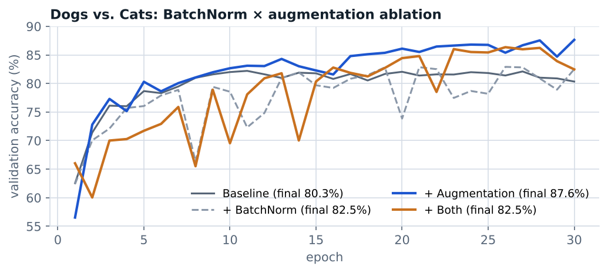

# What actually helps a small CNN generalize?

Deep Learning & AI, Peking University · October 2026 · individual work

**Report:** [report.pdf](report.pdf)

A 2 × 2 ablation on Dogs vs. Cats (15,000 training and 10,000 validation images): batch normalization on/off crossed with data augmentation (padded random crop + horizontal flip) on/off. Every arm uses the same 319,874-parameter CNN (three convolutional blocks, Kaiming initialization), the same random seed and batch order, and Adam with learning rate 10⁻³ for 30 epochs. Parameter counts were checked by hand against the model summary.

| Configuration | Best validation accuracy | Final (epoch 30) |
|---|---|---|
| Baseline | 82.21% (epoch 11) | 80.34% |
| + BatchNorm | 82.91% (epoch 26) | 82.51% |
| + Augmentation | 87.64% (epoch 30) | **87.64%** |
| + Both | 86.36% (epoch 26) | 82.47% |

**Findings.** Augmentation gave the largest gain (+7.3 points) and removed the late-epoch decline seen without it. BatchNorm added +2.2 points, mainly through steadier late training. The two did not stack; with one seed per arm, that interaction should be re-checked over several seeds before reading anything into it.

**Run it.** `cnn_ablation_bn_augmentation.ipynb` (PyTorch, GPU recommended). Download the Kaggle *Dogs vs. Cats* images and arrange them as `CatDog/train/{cats,dogs}` and `CatDog/validation/{cats,dogs}`, then set `data_dir` in the notebook. The dataset is not redistributed here. Notebook commentary is in Chinese.
