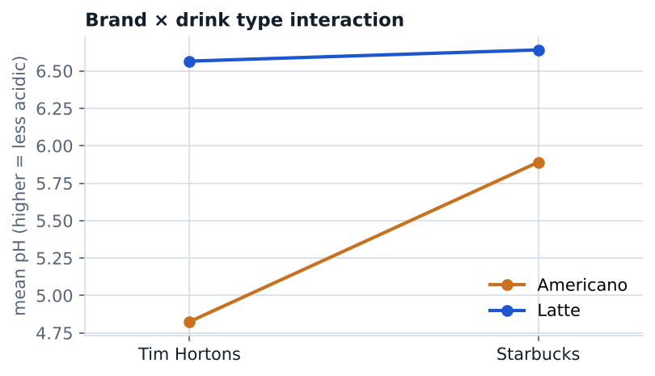

# A 2³ factorial experiment on coffee acidity

STAT 404 Design and Analysis of Experiments, UBC · November 2025 · course project, team of four

Which combination of coffee brand and drink type is least acidic? Treatment factors: brand (Tim Hortons, Starbucks) and type (Americano, latte); blocking factor: serving temperature (iced, hot); response: pH from a digital meter. Run order was randomized within each temperature block. With one run per cell, effects were screened with a half-normal plot.

**Result.** Drink type and brand stand out, with a strong brand × type interaction; a Starbucks latte had the highest pH (lowest acidity).

**My role:** I proposed the question, designed and ran the experiment, revised the analysis in R, and wrote the proposal and slides.

**Files.** `analysis.R`, `data/coffee_ph.csv` (our measurements), `slides.pdf`.
