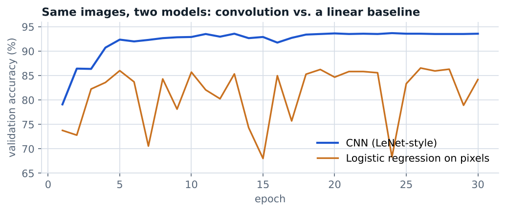

# Deep learning from first principles

Deep Learning & AI, Peking University · September–October 2026 · individual work

A sequence of PyTorch notebooks, from optimization basics to convolutional networks.

| Notebook | What it does |
|---|---|
| `01_gradient_descent_vs_ols.ipynb` | Simulation study (n = 1,000, p = 10, 100 replications) comparing closed-form OLS, full-batch gradient descent and mini-batch gradient descent, including how learning rate and batch count affect convergence. Mini-batch GD matches OLS to four decimals in RMSE (0.03897 vs. 0.03896). |
| `02_autograd_and_adam.ipynb` | Re-implements mini-batch GD with autograd, reproducing the hand-derived results exactly, and compares a constant learning rate with Adam. |
| `03_mlp_image_regression.ipynb` | Image processing with tensor operations (Sobel edges, sketch effects), then a two-hidden-layer MLP for regression on a 5,500-image face dataset. |
| `04_cnn_image_classification.ipynb` | A LeNet-style CNN for binary image classification on the same dataset: 93.6% validation accuracy vs. 84.2% for logistic regression on the same pixels, plus visualizations of learned filters. |

The face dataset was provided for the course and is not redistributed; face images and personal photos have been removed from the notebook outputs. Notebook commentary is in Chinese.
