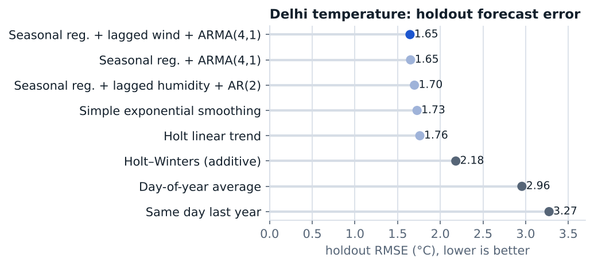

# Forecasting daily temperature in Delhi

STAT 443 Time Series and Forecasting, UBC · March 2026 · course project, team of four

Fifteen forecasting models for daily mean temperature in Delhi (January 2013 – April 2017), compared by holdout RMSE: seasonal benchmark rules, exponential smoothing, ARIMA, and regressions with sinusoidal seasonal terms, lagged weather covariates and ARMA errors.

**Result.** The best model is a sinusoidal seasonal regression with lagged wind speed and ARMA(4,1) errors (holdout RMSE 1.65 °C, against 3.27 °C for the same-day-last-year benchmark). Residual diagnostics (variogram, ACF/PACF, Q–Q plot) support a stationary ARMA error process.

**My role:** comparing the models and checking the final model's residuals, and writing up the results.

**Files.** `report.pdf` (full report). Data: [Daily Climate time series data, Kaggle](https://www.kaggle.com/datasets/sumanthvrao/daily-climate-time-series-data).
