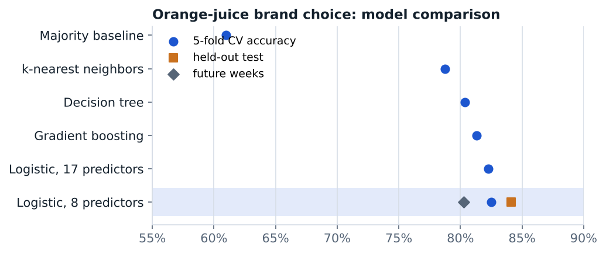

# A leakage-free model comparison for brand choice

Machine Learning & AI, Peking University · October 2026 · individual work

**Report:** [report.pdf](report.pdf)

Predict whether a shopper buys Citrus Hill or Minute Maid orange juice from 1,070 purchases (the *OJ* data from ISLP; Stine, Foster & Waterman, 1998), with an evaluation protocol that cannot leak information from the test set.

- scikit-learn `Pipeline`s, so one-hot encoding and scaling are fit inside each fold; the same five stratified folds for every model.
- Grid-searched logistic regression, k-nearest neighbors, a decision tree and gradient boosting against a majority-class baseline; bias–variance curves for KNN and tree depth.
- Showed that nine of the 17 predictors duplicate information in others (store recodings and derived price columns), and that a compact eight-predictor set loses nothing.
- Fixed the final model before opening the test set, evaluated it once, then stress-tested it with a train-on-early-weeks, test-on-later-weeks split.
- Interpreted the model with coefficients and permutation importance, and examined the most confident errors.

**Results.** Compact logistic regression (C = 0.1): 84.1% test accuracy and 0.92 ROC-AUC, against a 61% majority baseline; 80.3% accuracy and 0.89 AUC on future weeks. Loyalty to Citrus Hill dominates, followed by the price gap between brands.

**Run it.** `oj_brand_choice.ipynb` with `OJ.csv` in the same folder (Python, scikit-learn).
